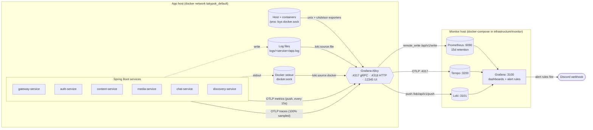
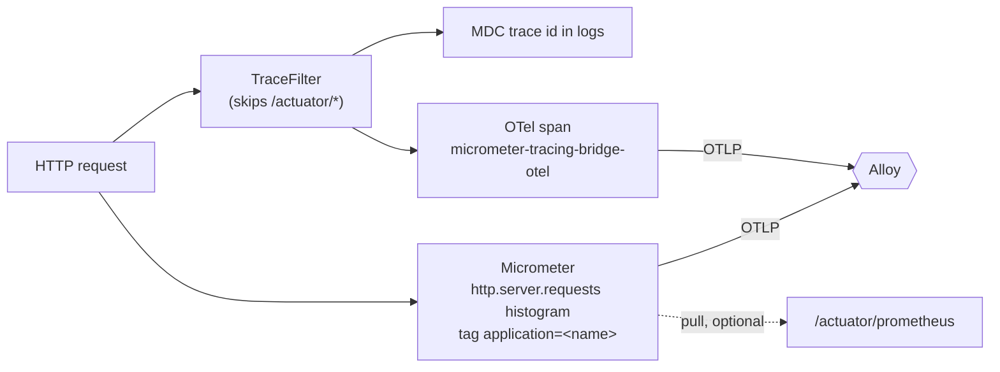
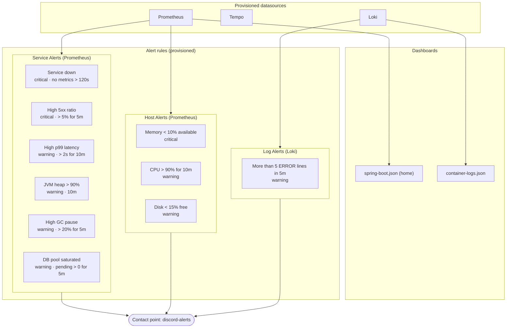

# Monitoring stack

How the backend is observed: **metrics**, **traces** and **logs** all flow through one collector (**Grafana Alloy**) into Prometheus, Tempo and Loki, and are viewed and alerted on in Grafana. Nothing scrapes the services; they push.

Sources: `backend/core-v1/src/main/resources/management.yml`, `backend/infrastructure/alloy/`, `backend/infrastructure/monitor/`.

## Overview

## Signal paths

| Signal | Produced by | Transport | Collector step | Stored in |
|---|---|---|---|---|
| App metrics (JVM, HTTP, Hikari/R2DBC) | Micrometer `micrometer-registry-otlp` | OTLP/HTTP push to `:4318/v1/metrics`, `step: 15s`, cumulative | `otelcol.receiver.otlp` → `batch` → `otelcol.exporter.prometheus` | Prometheus (remote_write) |
| Host + container metrics | Alloy `prometheus.exporter.unix` and `prometheus.exporter.cadvisor` | scraped inside Alloy every 15s | `prometheus.scrape` | Prometheus (remote_write) |
| Traces | Micrometer Tracing → OTel bridge | OTLP/HTTP push to `:4318/v1/traces` | `otelcol.receiver.otlp` → `batch` → `otelcol.exporter.otlp` | Tempo |
| Logs (Docker stdout) | container stdout | `loki.source.docker` | regex stage extracts `level` label | Loki |
| Logs (files) | log4j2 `RollingFile` → `<service>/app.log` | `loki.source.file` | multiline stage keeps stack traces together, extracts `level` | Loki |

Export is **off by default**: set `OTLP_EXPORT_ENABLED=true` on a service when Alloy is running. Spans are still created locally (trace ids still appear in logs), and `/actuator/prometheus` still works. In containers override the endpoints with `MANAGEMENT_OTLP_METRICS_EXPORT_URL` / `MANAGEMENT_OTLP_TRACING_ENDPOINT`.

## Inside the services

- Shared config lives in `core-v1` (`management.yml`) and is imported by the services, so each gets the same setup.
- `job` = `service.name` (the application name); `instance` = `service.instance.id` (`$HOSTNAME`), so scaled-out replicas show up separately.
- Actuator exposes `health,info,prometheus`. The gateway runs actuator on its own port `:8090`; Docker health checks hit `/actuator/health`.

## Grafana

Traces are explored from Grafana through the Tempo datasource (jump from a log line's trace id to the trace).

## Ports

| Component | Host port | Notes |
|---|---|---|
| Alloy OTLP gRPC / HTTP | 4317 / 4318 | services push here; Spring Boot uses 4318 |
| Alloy UI | 12345 | component graph, live debugging |
| Prometheus | 9090 | remote-write receiver enabled, exemplar storage on |
| Grafana | 3100 | default login `admin` / `admin` (change outside local) |
| Loki | 3101 | container port 3100; host 3100 belongs to Grafana |
| Tempo | 3200 | query API; its OTLP receivers are reachable only on the docker network |

## Deployment

- Two compose projects share the external docker network `takypok_default`: `infrastructure/alloy` (project `takypok-app`) next to the services, and `infrastructure/monitor` (project `takypok-monitor`) for Prometheus, Grafana, Tempo and Loki.
- In production these can sit on separate hosts. Alloy then only needs `LOKI_URL`, `PROMETHEUS_REMOTE_WRITE_URL` and `TEMPO_OTLP_ENDPOINT` pointing at the monitor host's private IP (see `alloy/.env.example`). The same Alloy can also run on the Redis host.
- `DISCORD_WEBHOOK_URL` is set in `infrastructure/monitor/.env` (gitignored).
- Per-container metrics (cAdvisor) need a native Linux Docker host; on Docker Desktop only host metrics and logs populate.
